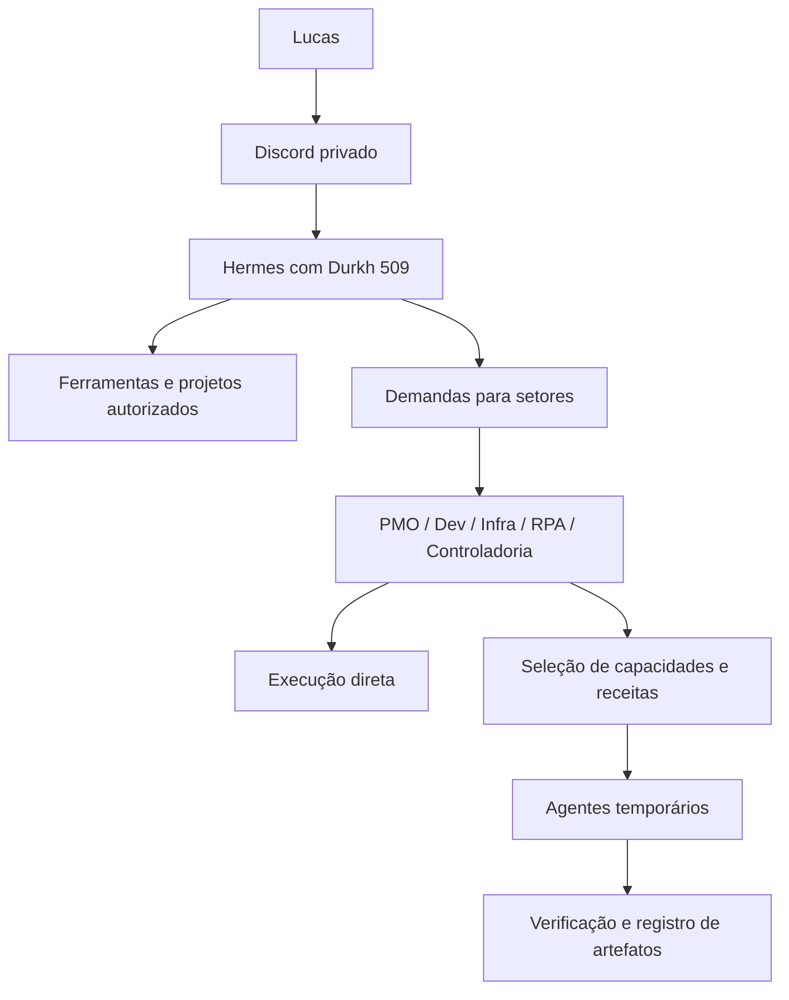

# Como funcionam Hermes e Durkh 509

[Voltar à experiência de Lucas](../README.md) · [Roteiro de implementação](Tutorial-Hermes-Durkh-509.md)

## A base e a personalização

O [Hermes Agent](https://github.com/NousResearch/hermes-agent), da Nous Research, é a base que conecta modelos/provedores a ferramentas e mantém a execução do agente. Sua documentação descreve terminal, gateways de mensagens, histórico de sessões, memória curada, skills, agendamentos, subagentes e integração MCP. Esses são recursos gerais do software; a configuração de cada instalação define o que está disponível.

Durkh 509 é a identidade e o modo de operação personalizados por Lucas. No ambiente documentado, a identidade é mantida em `SOUL.md`; configuração, sessões, memória e autenticação seguem no estado nativo do Hermes.

A integração com a OpenAI faz parte da experiência descrita por Lucas. Em uma instalação nova, a seleção de modelo e o método de autenticação seguem as opções suportadas pela versão do Hermes e pelo provedor escolhido.

## O papel de cada conexão

| Camada | O que faz neste ambiente |
| --- | --- |
| Modelo/provedor | Produz as respostas e decisões a partir do contexto e das ferramentas disponíveis. |
| Hermes | Organiza a execução, as ferramentas, as sessões e as interfaces do agente. |
| Identidade Durkh 509 | Define a personalização e o modo de colaboração com Lucas. |
| Discord e seus gateways | Recebem as mensagens e devolvem respostas nos canais e conversas configurados. |
| Ferramentas e SSH | Permitem executar ações nos ambientes autorizados, conforme a configuração de cada integração. |
| Documentação em Markdown / Obsidian | Mantém instruções e contexto nos arquivos oficiais dos projetos. |
| MCP e conhecimento | Oferecem interfaces para ferramentas e consulta às fontes permitidas. |
| n8n | Integra fluxos específicos, como admissão/projeção de chamados e geração de relatórios. |
| Hermes Control | Oferece um painel complementar de contexto, visão global, projetos e ações. |

O histórico de sessões ajuda a retomar conversas e execuções. O versionamento de arquivos e código pertence às práticas Git dos projetos. As consultas de documentos e a execução de rotinas dependem das ferramentas conectadas ao ambiente. O [Factorio — Durkh Coop](https://github.com/DURKHEIM09/factorio-durkh-coop) apresenta um exemplo público dessa integração.

## Agente central, diretores e workers

Esse desenho resume a experiência de interação. Os diretores são pares na arquitetura documentada; a preferência de Lucas por conversar com o 509 não implica uma chefia técnica obrigatória dele sobre todos os setores.

| Agente | Papel descrito por Lucas |
| --- | --- |
| Durkh 509 | Ponto principal de interação e trabalho pessoal. |
| Durkh PMO | Estruturação inicial, perguntas, requisitos e padrões de projeto. |
| Durkh Dev | Desenvolvimento e coordenação das frentes de código. |
| Durkh Infra | Sistemas, redes, acessos e infraestrutura. |
| Durkh RPA e Automação | Automações, workflows e robôs. |
| Durkh Controladoria | Qualidade documental, acompanhamento e fiscalização das áreas. |

Os agentes setoriais são persistentes. Workers temporários executam escopos delimitados e devolvem artefatos para verificação; a arquitetura documentada os trata como folhas, sem autoridade setorial ou memória global própria.

## Chamados, habilidades e conhecimento

A entrada documentada de chamados usa contrato/CLI, integração n8n, API Python de admissão e Kanban Hermes. O Kanban mantém o estado autoritativo; o Discord apresenta threads e atualizações. A DKR Control API inclui outbox, retry e deduplicação. A referência ao Jira é uma analogia de uso.

O acervo de habilidades reúne skills, personas e referências curadas. Sua seleção pode compor receitas versionadas com ferramentas, raízes permitidas, critérios de aceite e hashes. O fluxo registrado é **preparar → delegar → verificar → registrar**. Estar no catálogo não equivale a instalar ou ativar tudo no agente.

A documentação registra consulta lexical FTS5 no conhecimento. A organização das fontes e a recuperação para contexto sustentam a comparação de Lucas com uma base de consulta; uma busca semântica não foi demonstrada nessas fontes.

## Estágio documentado

Há registro de um canário PMO → Dev → MCP → Discord, recuperação de falha do n8n e um canário SQL com worker temporário. A integração geral entre chamado, receita, execução e progresso ainda tem partes pendentes nos documentos. A experiência relatada com delegação simultânea permanece identificada como relato de Lucas.

O Hermes Control 2.0 documenta Contexto, Visão global, Projetos e Ações. A interface de voz é um projeto complementar, com canário funcional e pendências de latência, naturalidade e interrupção. Esses componentes serão detalhados em seus próprios materiais.

[Software e documentação oficial do Hermes](https://github.com/NousResearch/hermes-agent). Esta síntese descreve as integrações registradas nos documentos do projeto e distingue os resultados históricos das partes ainda em evolução.
